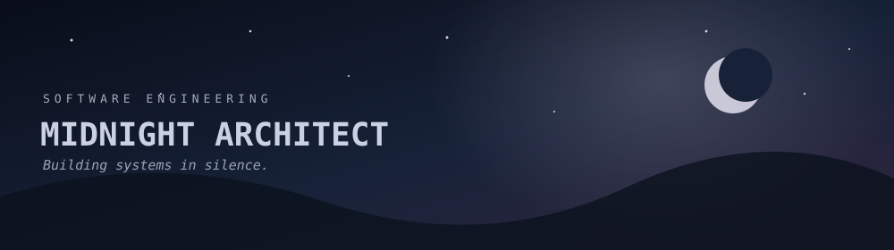

  

   

  # MIDNIGHT ARCHITECT

  *Building systems in silence.*

  **Software Engineering Student · Backend Development · Java & Spring Boot**

  ---

## About Me

I'm a Software Engineering student at **FPT University Ho Chi Minh City**, currently focusing on backend development with Java and Spring Boot.

I enjoy designing APIs, structuring projects around maintainable architecture, and understanding how systems work beneath the surface — not just making them work.

My goal is to become a backend engineer who builds reliable systems before chasing complexity.

## Current Focus

- Building backend applications with Spring Boot
- REST API design and authentication with JWT
- SQL Server and relational database design
- Modular project architecture and maintainable code
- Learning software engineering and system design fundamentals

## Tech Stack

**Languages**

  

**Backend Development**

  

**Database**

`Microsoft SQL Server` · `Spring Data JPA`

**Development Tools**

  

## Featured Project

### ChayBook — Vegetarian Community Platform

A university team project focused on building a community platform for people interested in vegetarian lifestyles.

**My Role: Backend Developer**

- Designed the initial backend architecture using a package-by-module structure.
- Developed backend entities and relational data models.
- Implemented REST APIs using Java and Spring Boot.
- Worked on authentication and JWT-based security.
- Supported API integration and backend consistency across the team.

**Tech Stack**

`Java` `Spring Boot` `Spring Data JPA` `Microsoft SQL Server` `JWT`

## Engineering Philosophy

> Good software is often invisible.

I believe clean architecture isn't about writing more layers — it's about making tomorrow's code easier to understand than today's.

I prefer understanding the reasoning behind a solution over simply making it work.

## GitHub Stats

## Connect

  
  &nbsp;
  

---

*One more commit before sunrise.*

Quietly building. Constantly learning.

